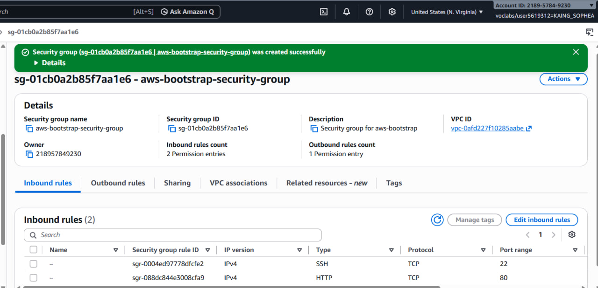
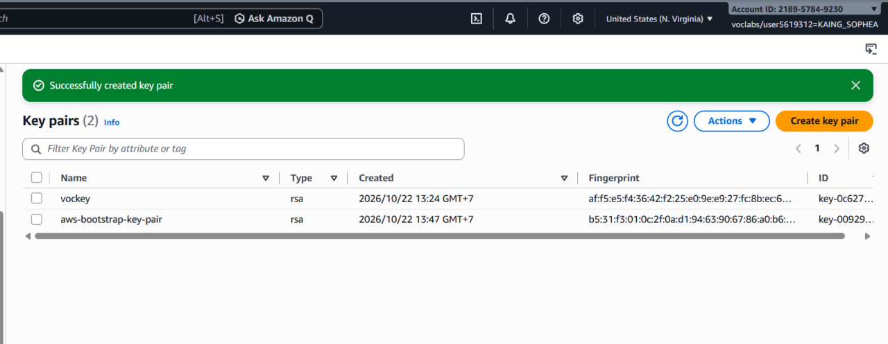
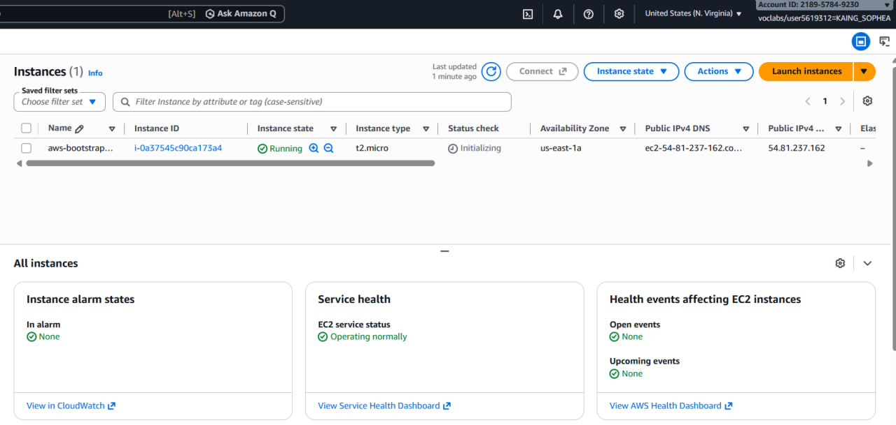
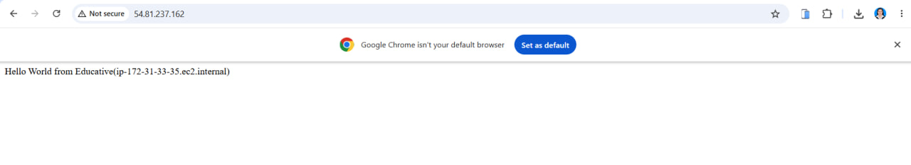
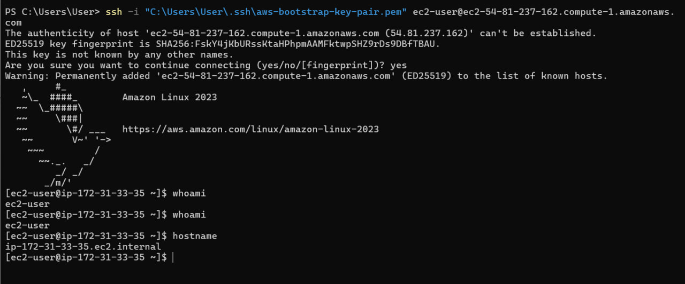
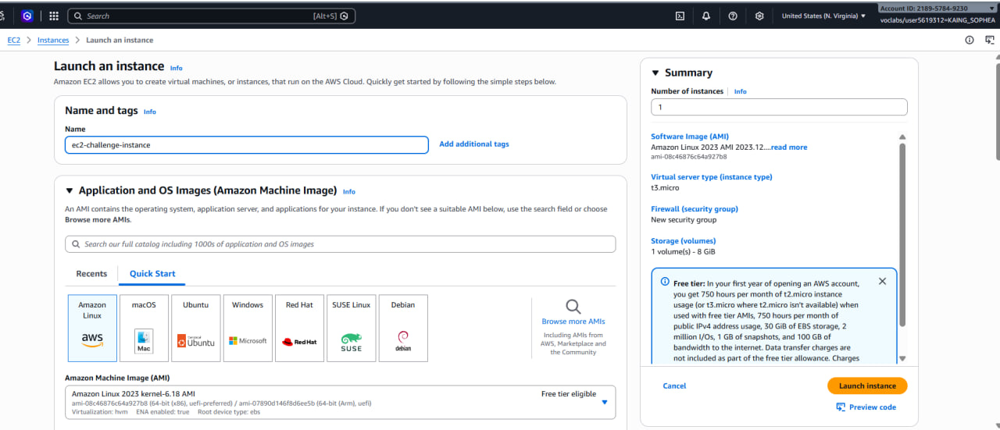
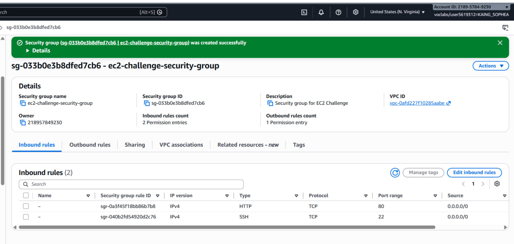
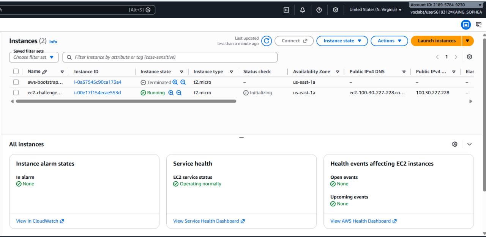
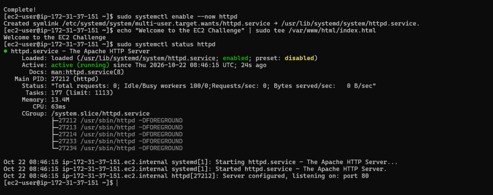
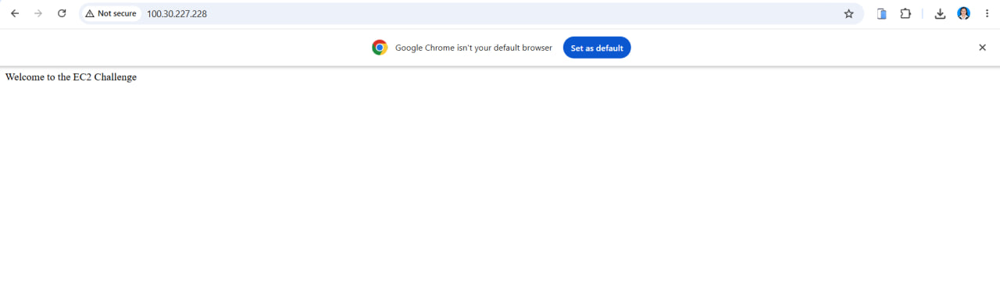

# Cloud Computing Lab 1: AWS EC2

## Student Information

- **Student Name:** KAING Sophea
- **Student ID:** e20220329
- **Learner Lab Username:** KAING_SOPHEA
- **Date Completed:** 2026-10-22

---

## Part 1.1 — An Amazon EC2 Walkthrough

### 1. Security Group



### 2. Key Pair



### 3. Instance Details



### 4. Browser Test



### 5. SSH connection



---

## Part 1.2: EC2 Web Solution (Challenge)

### 1. Launch configuration



### 2. Security Group



### 3. Running Instance



### 4. Commands on the instance

Connected to the instance using SSH and ran the following commands:

```bash
sudo dnf update -y
sudo dnf install -y httpd
sudo systemctl enable --now httpd
echo "Welcome to the EC2 Challenge" | sudo tee /var/www/html/index.html
sudo systemctl status httpd
```

These commands updated the system, installed Apache, started the web server, enabled it at boot, and created the challenge webpage.



### 5. Browser test

**Welcome to the EC2 Challenge**



---

## Questions and Answers

### Q1. Why do we need to configure inbound rules in a security group?

Inbound rules control which incoming network connections are allowed to reach an EC2 instance. SSH on port 22 allows remote terminal access, while HTTP on port 80 allows users to access a website. Without the HTTP rule, external users cannot access the website through the security group, even if Apache is running.

### Q2. How was the web server installed in Part 1.1?

The web server was installed automatically using EC2 user data when the instance started for the first time. The script installed Apache, started the service, and created an HTML page in `/var/www/html/index.html`.

### Q3. Why does HTTP work, but HTTPS does not?

HTTP works because Apache is serving the website over port 80, and the security group allows inbound HTTP traffic. HTTPS requires TLS/SSL configuration and a suitable certificate. These were not configured in this lab.

### Q4. How did you configure and verify the 10 GiB storage volume?

I configured the root volume to 10 GiB during the EC2 instance launch process. I could verify the configured size in the EC2 instance's **Storage** tab by checking the attached EBS volume details.

---

## Cleanup

After completing the lab, I cleaned up the AWS resources to avoid unnecessary charges.

- [x] Terminated the Part 1.1 EC2 instance.
- [x] Deleted the Part 1.1 key pair.
- [x] Deleted the Part 1.1 security group.
- [x] Terminated the Part 1.2 EC2 instance.
- [x] Deleted the Part 1.2 key pair.
- [x] Deleted the Part 1.2 security group.

**Note:** Mark each cleanup item as completed only after you have confirmed that the resource was deleted in AWS.

---

## Conclusion

In this lab, I learned how to create security groups and key pairs, launch and configure EC2 instances, connect to Linux instances using SSH, install and configure an Apache web server, and test a website using a public IPv4 address. I also learned how to configure EBS storage and clean up AWS resources after completing the lab.
