# Cloud Lab 2 — Application Load Balancer with an EC2 Auto Scaling Group


## Student name: KAING Sophea
## Student ID: e20220329

| Region | US East (N. Virginia) `us-east-1` |
| Services | Elastic Load Balancing (ALB), Amazon EC2 Auto Scaling, Amazon EC2 |

## 1. Objective

Create an Application Load Balancer (ALB) and a target group, create a launch template and an Auto Scaling group (ASG) attached to the load balancer, then test load balancing and observe how a failed instance is detected and replaced automatically.

## 2. Key concepts

- **Load balancer:** the single entry point for clients. It receives requests and forwards them to healthy registered instances. An ALB works at layer 7 (HTTP).
- **Target group:** the group of instances (targets) that the load balancer sends traffic to. It also runs health checks on them.
- **Health check:** every 30 seconds the target group requests `/` on each instance. A response other than `200` is a failure; 2 failures in a row mark the instance **unhealthy**, and 5 successes in a row mark it **healthy**.
- **Launch template:** the blueprint (AMI, instance type, security group, user data) the ASG uses to launch instances.
- **Auto Scaling group:** keeps the number of running instances between the minimum and maximum. With ELB health checks turned on, it replaces instances that the load balancer reports as unhealthy.

## 3. Task 1 — Security groups

`LoadBalancerSecurityGroup` allows HTTP (80) from anywhere so that clients can reach the load balancer.

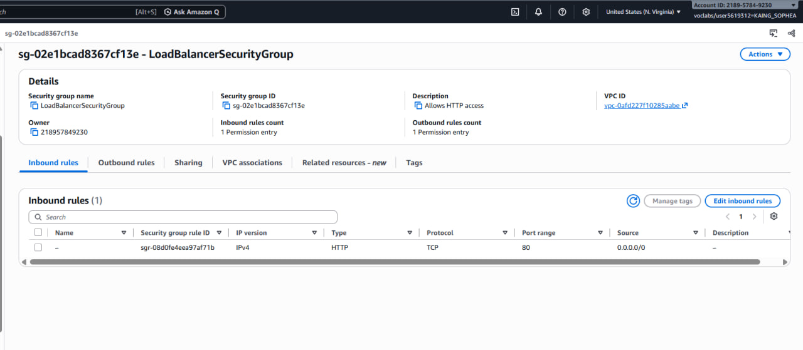

`LaunchTemplateSecurityGroup` allows HTTP (80) for the web server and SSH (22) for EC2 Instance Connect.

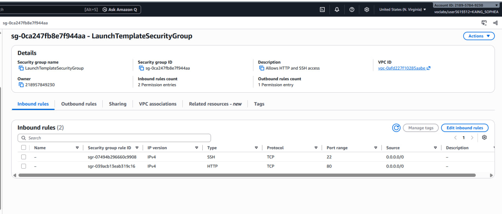

## 4. Task 2 — Target group

`LoadBalancerTargetGroup`: target type Instances, protocol HTTP, port 80, default VPC. No targets were registered manually; the ASG registers them.

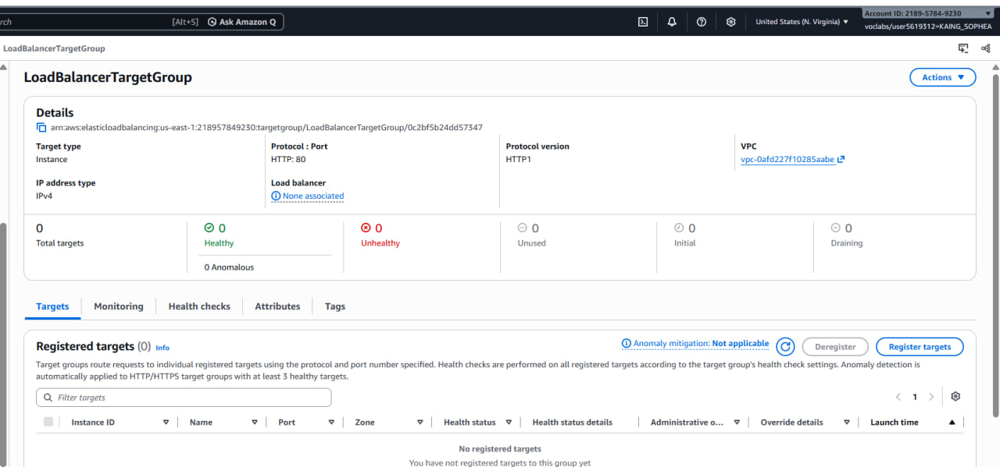

Health checks use the default settings: HTTP, path `/`, interval 30 seconds, timeout 5 seconds, unhealthy threshold 2, healthy threshold 5, success code 200.

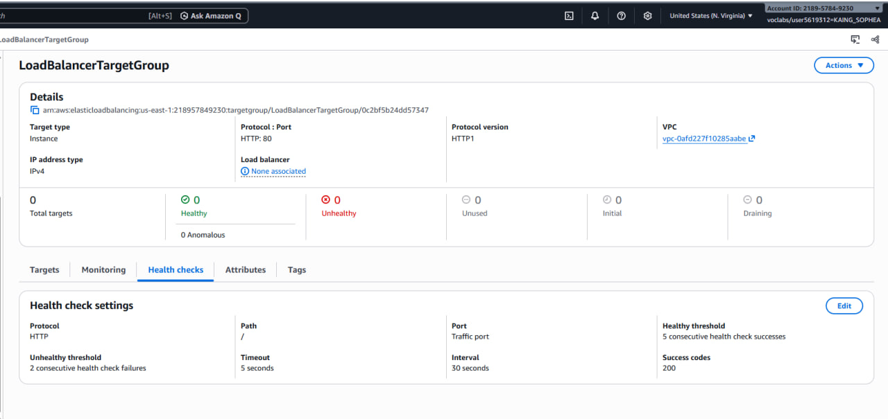

## 5. Task 3 — Application Load Balancer

`MyLoadBalancer`: internet-facing, IPv4, default VPC, all Availability Zones, security group `LoadBalancerSecurityGroup`, listener HTTP:80 forwarding to `LoadBalancerTargetGroup`.

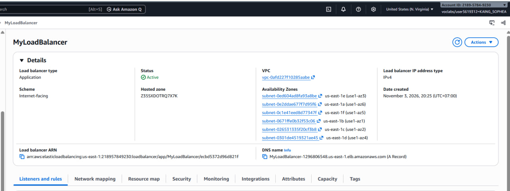

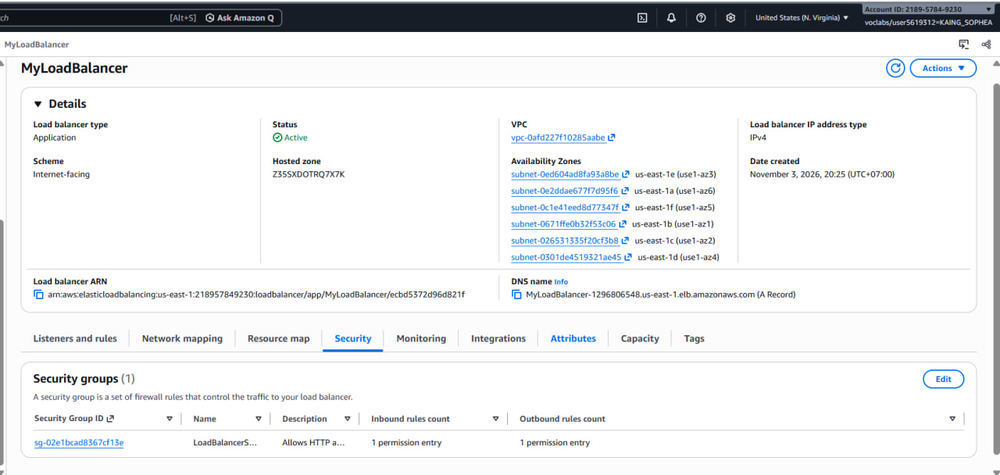

## 6. Task 4 — Launch template and Auto Scaling group

`AutoScalingLaunchTemplate`: Amazon Linux 2023, `t2.micro`, `LaunchTemplateSecurityGroup`, and a user data script that installs and starts Apache (`httpd`) and writes `Hello World from (hostname)` to `index.html`.

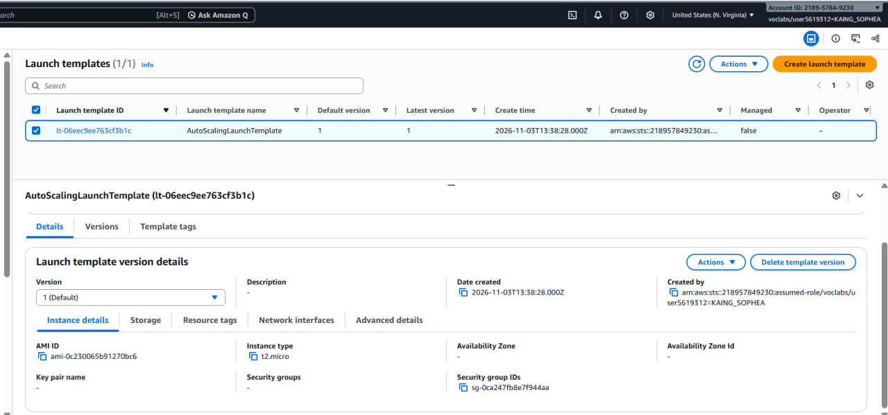

`MyAutoScalingGroup`: default VPC, all Availability Zones, attached to `LoadBalancerTargetGroup`, Elastic Load Balancing health checks turned on, desired 2, minimum 2, maximum 3.

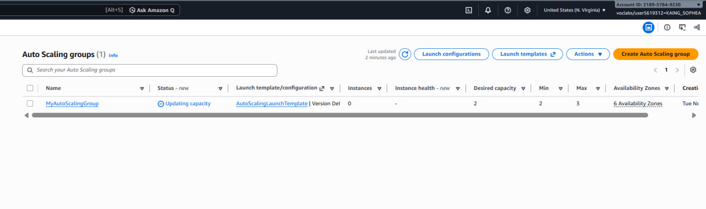

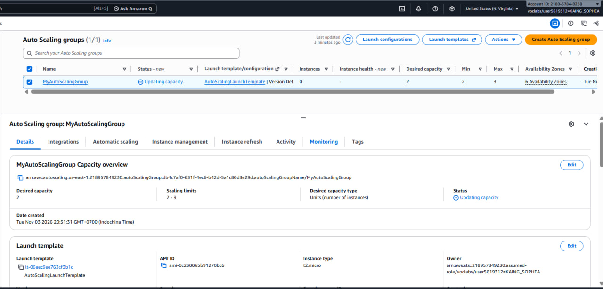

## 7. Task 5 — Testing

### Load balancing

Opening the load balancer's DNS name shows the host name of the instance that served the request. After refreshing, a different host name appears, so requests are spread across both instances.

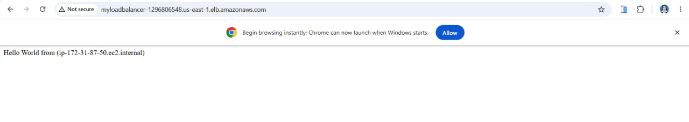

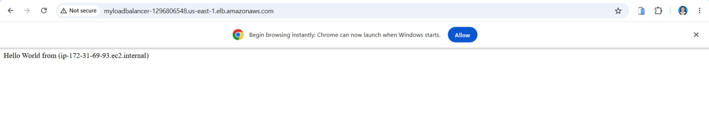

### Simulated application failure

The web server was stopped on one instance (`i-0b4b5c5d9dd9e1c56`) with EC2 Instance Connect. The instance kept running, but its application no longer answered.

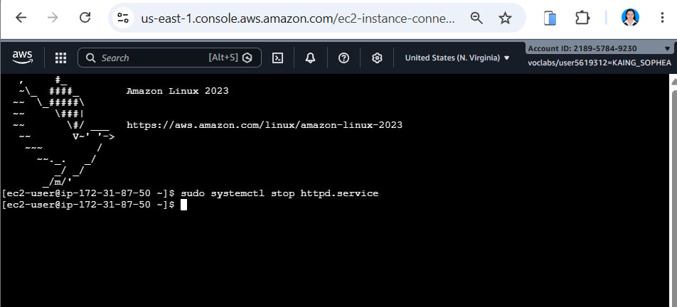

After two failed health checks, the target became **Unhealthy** and then **Draining**.

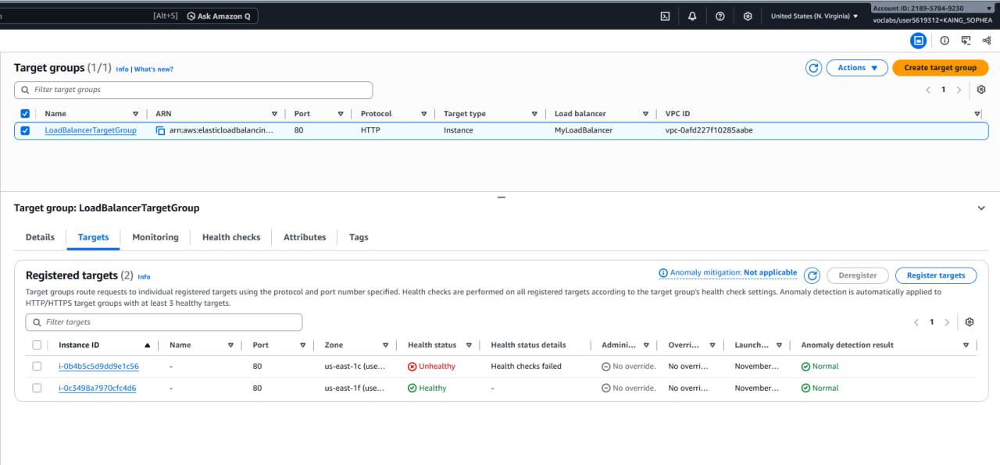

The Auto Scaling group terminated it and launched a replacement (`i-03dee1ac81aa2b6f4`), which became **Healthy** after passing its health checks. The other instance stayed healthy, so the website stayed available during the failure.

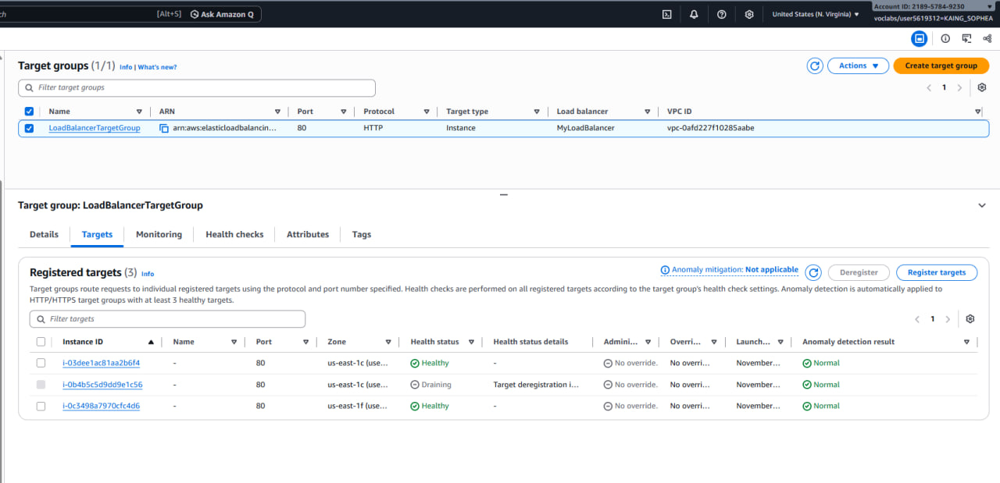

## 8. Problem encountered and solution

**Problem:** After the ASG launched its first instances, every target stayed **Unhealthy**, and the ASG kept replacing them. The instances were running with 2/2 status checks passed, but opening an instance's public IP in a browser gave `ERR_CONNECTION_REFUSED`, so nothing was listening on port 80.

**Cause:** The cloud-init log showed that the user data script failed immediately:

```text
cc_scripts_user.py[WARNING]: Failed to run module scripts-user
```

Inspecting the script with `sudo head -3 /var/lib/cloud/instance/scripts/part-001 | cat -A` showed that every line started with three spaces (`   #!/bin/bash`), copied from the indented code block in the instructions. A script only runs if `#!` is the very first two characters of the file, so `httpd` was never installed.

**Solution:** I created version 2 of the launch template with the user data starting exactly at `#!/bin/bash`, set it as the default version, updated the ASG to use it, and terminated the old instances. The new instances served the page and became healthy.

**Lesson:** EC2 status checks only test the machine, while ALB health checks test the application. Checking `/var/log/cloud-init-output.log` is the quickest way to debug user data.

## 9. Clean up

All resources were deleted in reverse order of creation: Auto Scaling group (which terminated its instances), launch template, load balancer, target group, and both security groups.

## 10. Conclusion

The Application Load Balancer distributed requests across the instances in the Auto Scaling group, and the combination of ALB health checks and the ASG made the application self-healing: a failed web server was detected within about a minute and replaced automatically without any manual action.
