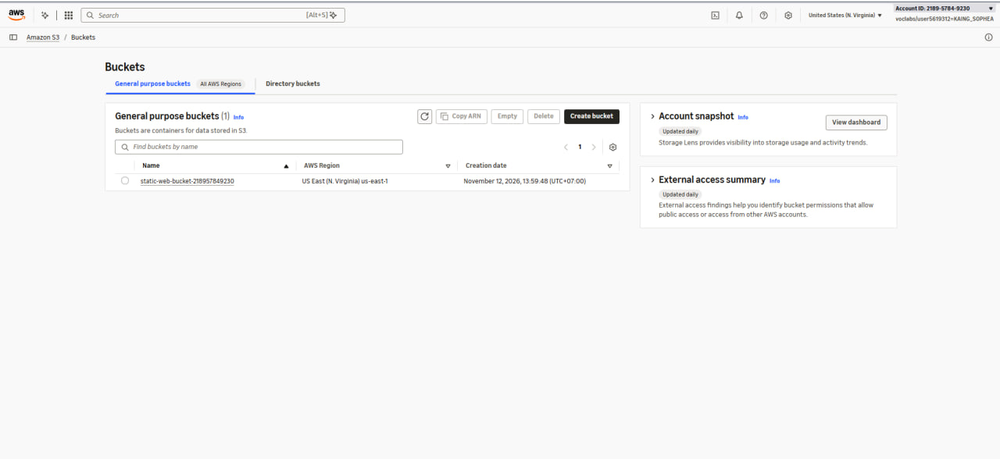
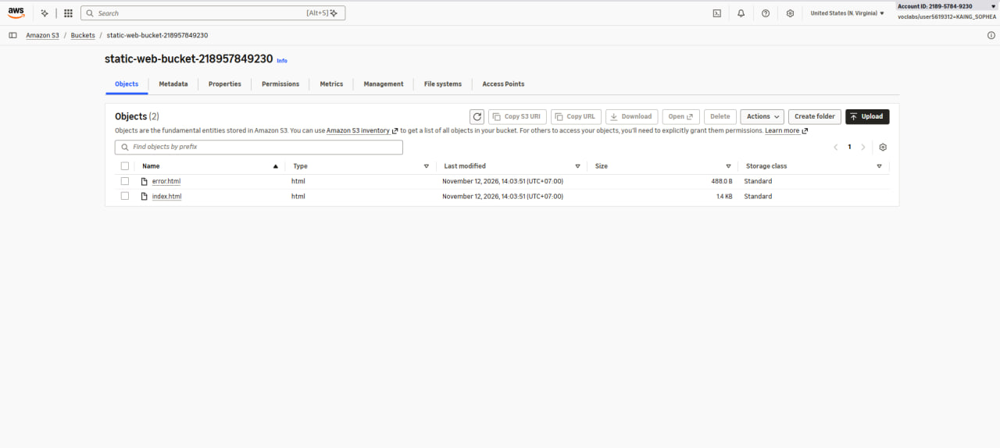
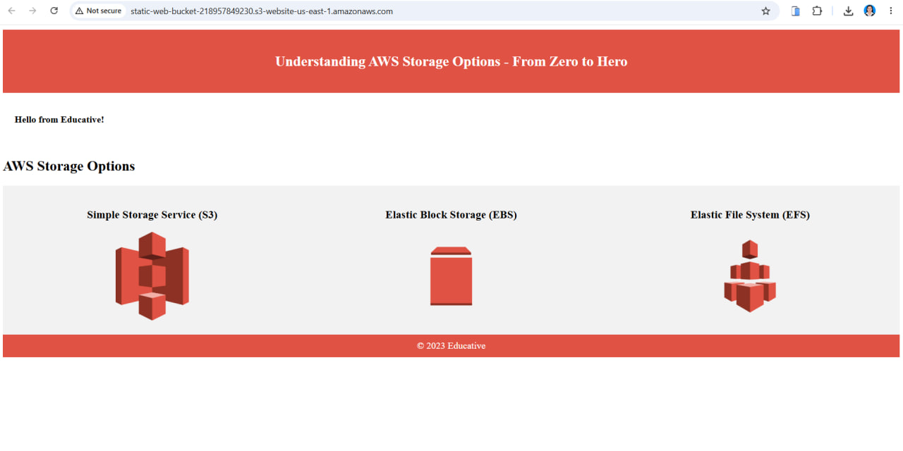
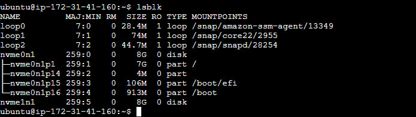
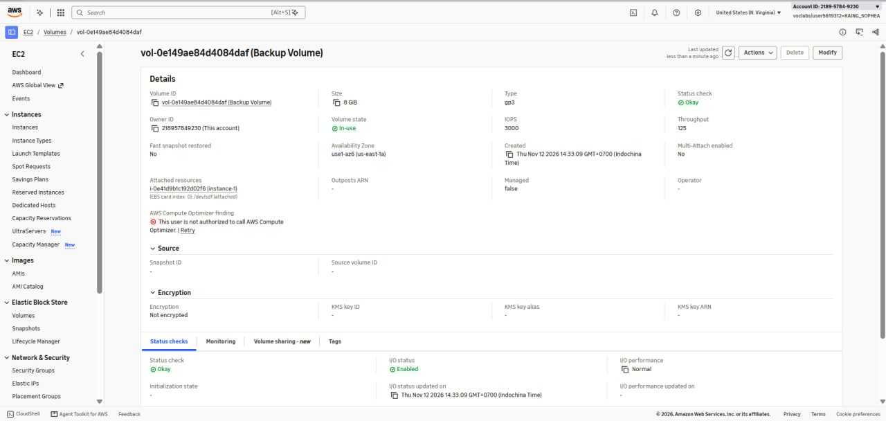
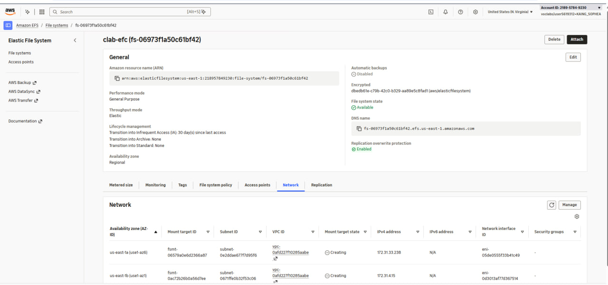
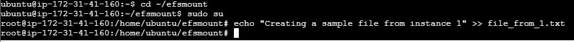
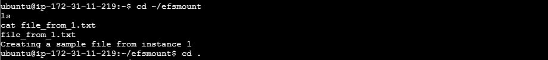

# Cloud Lab 3: Understanding AWS Storage Options

| Item | Details |
|---|---|
| Name | KAING Sophea |
| Student ID | e20220329 |
| Region | US East (N. Virginia) `us-east-1` |
| Parts | 2.1 Amazon S3, 2.2 Amazon EBS, 2.3 Amazon EFS |

---

## Part 2.1: Amazon S3

### Task 1: Create a bucket and upload files

I created the bucket `static-web-bucket-218957849230` in `us-east-1` with **Block all public access** turned off. I then uploaded `index.html` and `error.html`.

**Screenshot 01: S3 bucket list**



**Screenshot 02: Files inside the bucket**



### Task 2: Static website hosting

I enabled static website hosting with `index.html` as the index document and `error.html` as the error document. At first the website endpoint returned **403 Forbidden**, because turning off Block Public Access alone does not make a bucket public. I then added this bucket policy, which allows everyone to read the objects:

```json
{
    "Version": "2012-10-17",
    "Statement": [
        {
            "Sid": "Statement1",
            "Principal": "*",
            "Effect": "Allow",
            "Action": ["s3:GetObject"],
            "Resource": "arn:aws:s3:::static-web-bucket-218957849230/*"
        }
    ]
}
```

After saving the policy, the website endpoint showed the page.

**Screenshot 03: Static website in the browser**



---

## Part 2.2: Amazon EBS

### Tasks 3 and 4: Instances and volume

I created the security group `ec2instances-sg` (SSH from Anywhere-IPv4) and launched `instance-1` and `instance-2` (Ubuntu 24.04, t3.medium, us-east-1a). I then created an 8 GiB gp3 volume named **Backup Volume** in us-east-1a.

### Task 5: Attach and mount the volume

I attached Backup Volume to `instance-1` as `/dev/sdf`. On this t3 instance the volume appeared as the NVMe device `nvme1n1`. I formatted it with ext4, mounted it on `/mnt/my-ebs-volume`, and created `testfile.txt`.

```bash
sudo mkfs -t ext4 /dev/nvme1n1
sudo mkdir /mnt/my-ebs-volume
sudo mount /dev/nvme1n1 /mnt/my-ebs-volume
echo "This is a test file" > testfile.txt
```

**Screenshot 05: `lsblk` output**



**Screenshot 04: Volumes page, Backup Volume In-use**



### Task 6: Move the volume to instance-2

I unmounted the volume on `instance-1`, detached it, and attached it to `instance-2`. I mounted it there without running `mkfs` again, and `testfile.txt` was still on the volume. This shows that data on an EBS volume persists independently of the instance.

**Screenshot 06: `cat testfile.txt` on instance-2**


---

## Part 2.3: Amazon EFS

### Task 7: Create the file system

I created the security group `efs-sg` (NFS from Anywhere-IPv4) and the Regional file system `clab-efs` (Enhanced, Elastic throughput, automatic backups off). It has two mount targets, in us-east-1a and us-east-1b, both using `efs-sg`.

**Screenshot 07: EFS file system and mount targets**



### Task 8: Third instance

I launched `instance-3` in the default subnet of **us-east-1b**, with the security group `ec2instances-sg`.

### Task 9: Mount EFS

I mounted `clab-efs` (`fs-06973f1a50c61bf42`) on `instance-1` and `instance-3` at `/home/ubuntu/efsmount` using the standard NFS client:

```bash
sudo apt-get -y install nfs-common
sudo mkdir -p /home/ubuntu/efsmount/
sudo mount -t nfs4 -o nfsvers=4.1,rsize=1048576,wsize=1048576,hard,timeo=600,retrans=2,noresvport fs-06973f1a50c61bf42.efs.us-east-1.amazonaws.com:/ /home/ubuntu/efsmount
```

### Task 10: Share a file between instances

On `instance-1` I created `file_from_1.txt` in the EFS mount. On `instance-3` I listed the mount and read the same file, which shows that both instances share one file system.

**Screenshot 08: Writing the file on instance-1**



**Screenshot 09: Reading the file on instance-3**



---


## Clean up

After taking all screenshots, I terminated the three instances, deleted the EFS file system and the EBS volume, deleted the two security groups, and emptied and deleted the S3 bucket.
