# Cloud Lab 4 — Amazon VPC with Public and Private Subnets

## 1. Lab Information

| Item | Details |
|---|---|
| Name | KAING Sophea |
| ID | e20220329 |
| Lab | Lab 4 |
| Topic | Amazon VPC with Public and Private Subnets |
| Platform | AWS Academy Learner Lab |
| Region | US East (N. Virginia) - us-east-1 |
| Service | Amazon VPC, EC2, Internet Gateway, NAT Gateway, AWS Systems Manager |

## 2. Objectives

The objectives of this lab are:

- Create an Amazon VPC and attach an Internet Gateway.
- Create public and private subnets.
- Configure route tables and subnet associations.
- Create a NAT Gateway to provide internet access to private instances.
- Launch EC2 instances in public and private subnets.
- Use AWS Systems Manager Run Command to test internet connectivity.

## 3. Implementation

### Task 1: Create a VPC

Created a VPC named `lab4-vpc` with IPv4 CIDR block `10.0.0.0/24`.

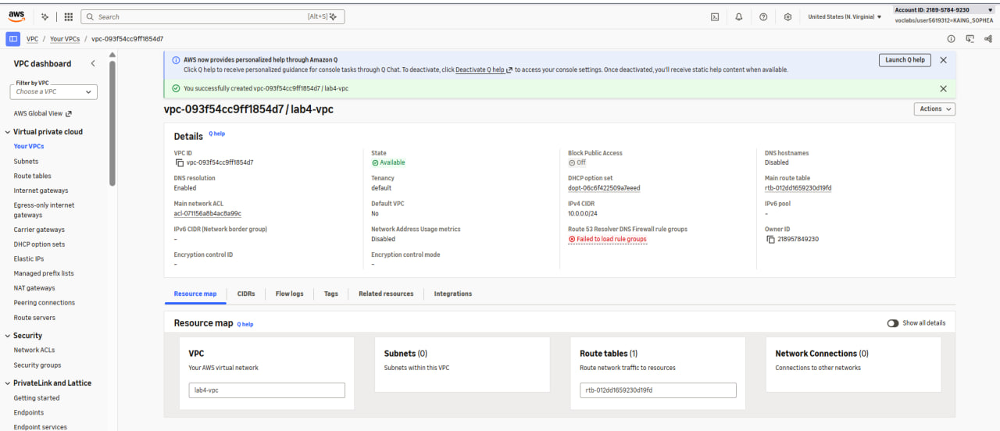

### Task 2: Create an Internet Gateway

Created an Internet Gateway named `lab4-internet-gateway` and attached it to `lab4-vpc` to allow communication between the VPC and the internet.

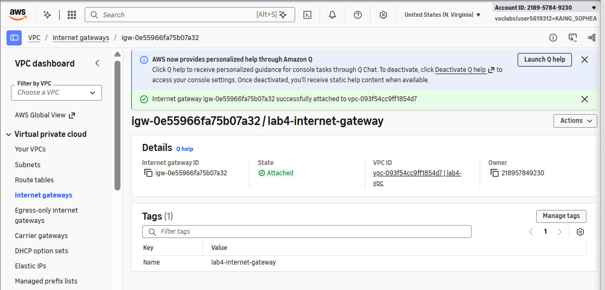

### Task 3: Create a Public Subnet

Created a public subnet named `lab4-public-subnet` with CIDR block `10.0.0.0/25` in Availability Zone `us-east-1a`.

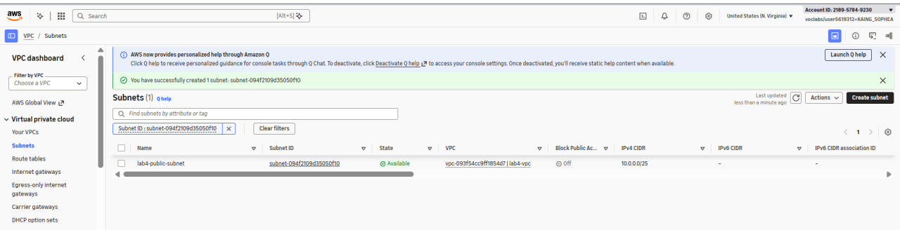

### Task 4: Configure the Public Route Table

Updated the VPC route table by adding a default route `0.0.0.0/0` pointing to `lab4-internet-gateway`. Associated the route table with `lab4-public-subnet`.

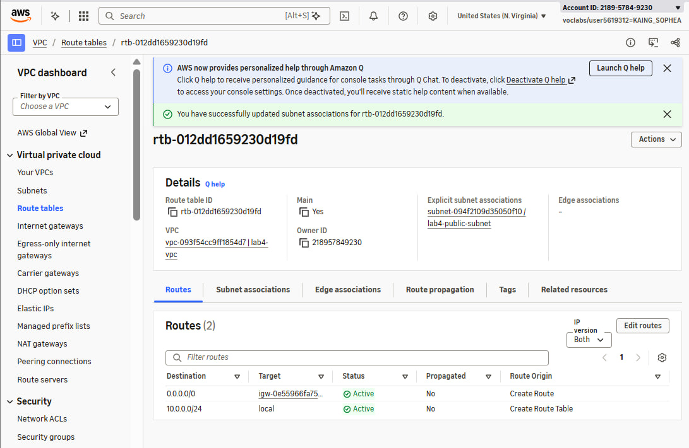

### Task 5: Launch a Public EC2 Instance

Launched an EC2 instance named `lab4-ec2-01` in `lab4-public-subnet` using Amazon Linux 2 and instance type `t2.micro`. Enabled auto-assign public IP.

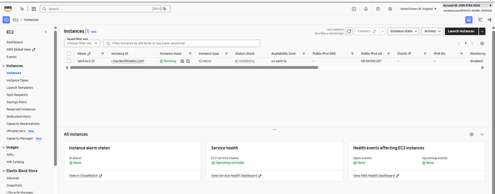

### Task 6: Test Public Internet Access

Used AWS Systems Manager Run Command with `AWS-RunShellScript` to execute:

```bash
sudo yum update -y
```

The command completed successfully, confirming that the public EC2 instance could access the internet.

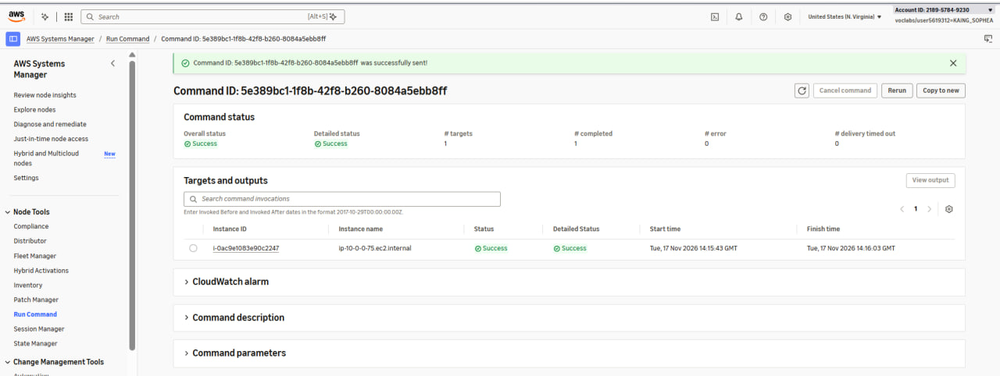

### Task 7: Create a Private Subnet

Created a private subnet named `lab4-private-subnet` with CIDR block `10.0.0.128/25` in Availability Zone `us-east-1a`.

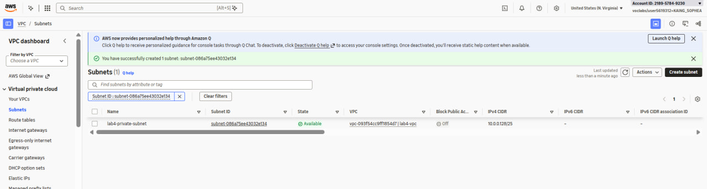

### Task 8: Create a NAT Gateway

Created a public NAT Gateway named `lab4-nat-gateway` inside `lab4-public-subnet` and allocated an Elastic IP address.

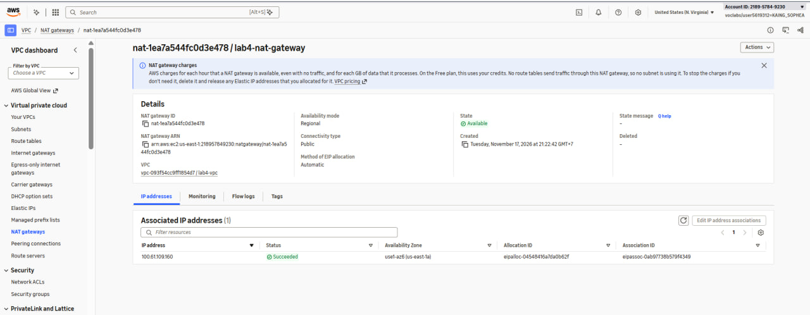

### Task 9: Configure the Private Route Table

Created a route table named `lab4-custom-route-table` and added a default route `0.0.0.0/0` pointing to `lab4-nat-gateway`. Associated the route table with `lab4-private-subnet`.

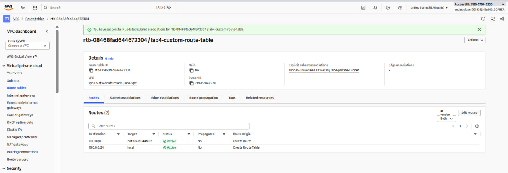

### Task 10: Launch a Private EC2 Instance

Launched an EC2 instance named `lab4-ec2-02` in `lab4-private-subnet` using Amazon Linux 2 and instance type `t2.micro`. Disabled auto-assign public IP.

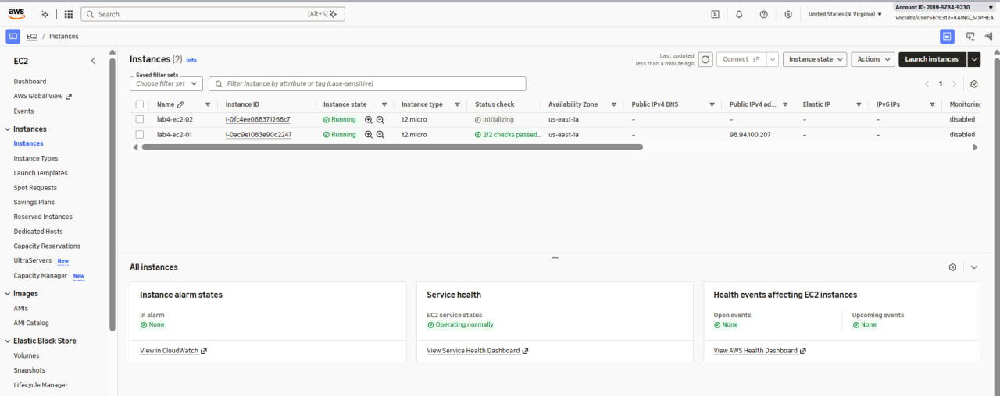

### Task 11: Test Private Internet Access

Used AWS Systems Manager Run Command with `AWS-RunShellScript` to execute:

```bash
sudo yum update -y
```

The command completed successfully, confirming that the private EC2 instance could access the internet through the NAT Gateway without having a public IP address.

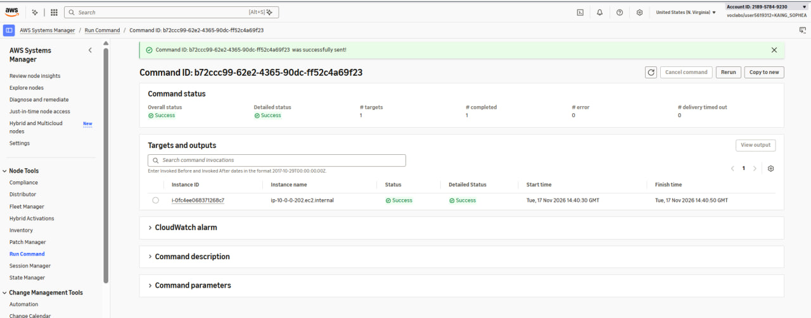

## 4. Conclusion

In this lab, I learned how to create and configure an Amazon VPC with public and private subnets. I configured an Internet Gateway for the public subnet and a NAT Gateway for the private subnet.

I also launched two EC2 instances and used AWS Systems Manager to test their internet connectivity. The public instance accessed the internet through the Internet Gateway, while the private instance accessed it through the NAT Gateway.

This lab helped me understand VPC networking, subnet configuration, route tables, and internet connectivity in AWS.
